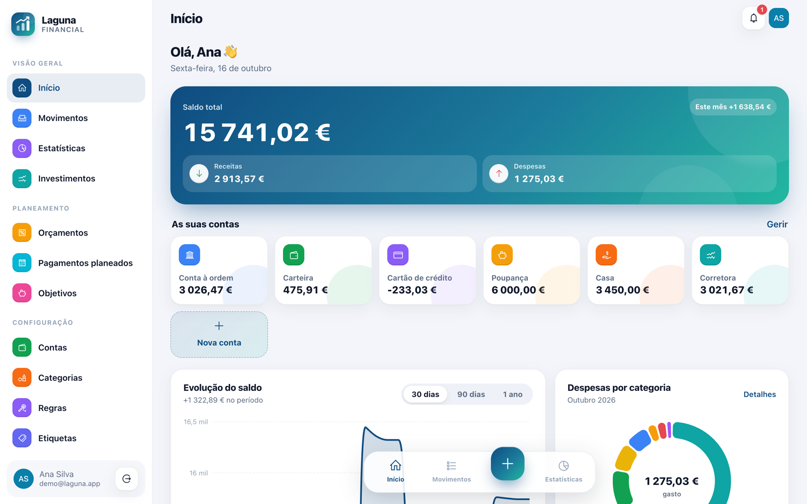
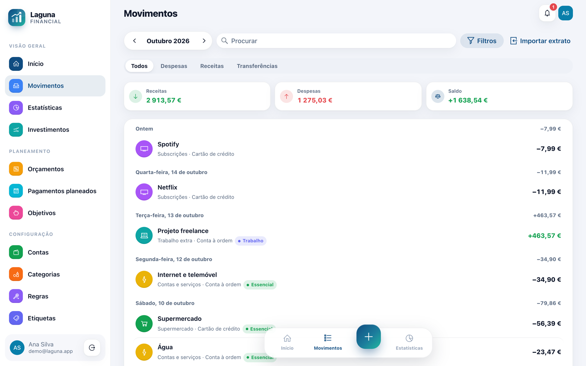
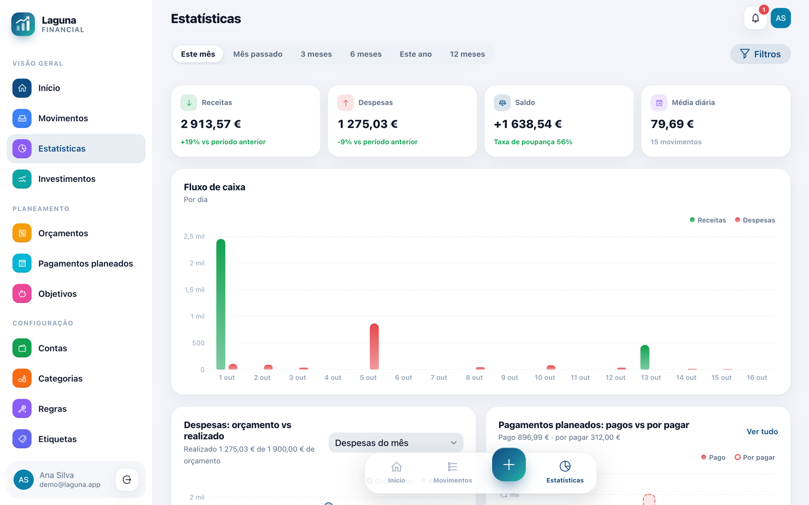
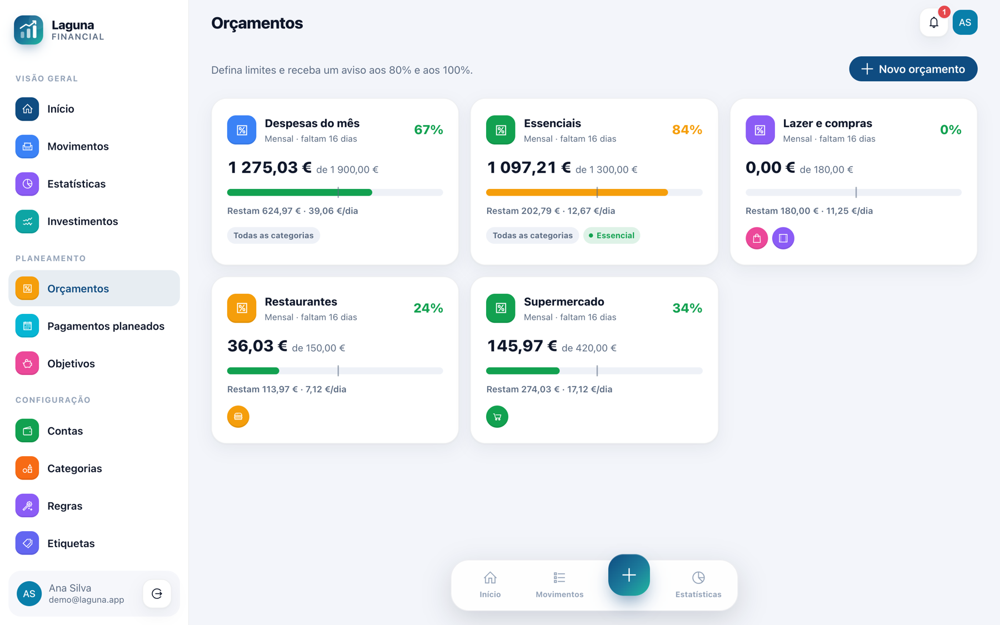
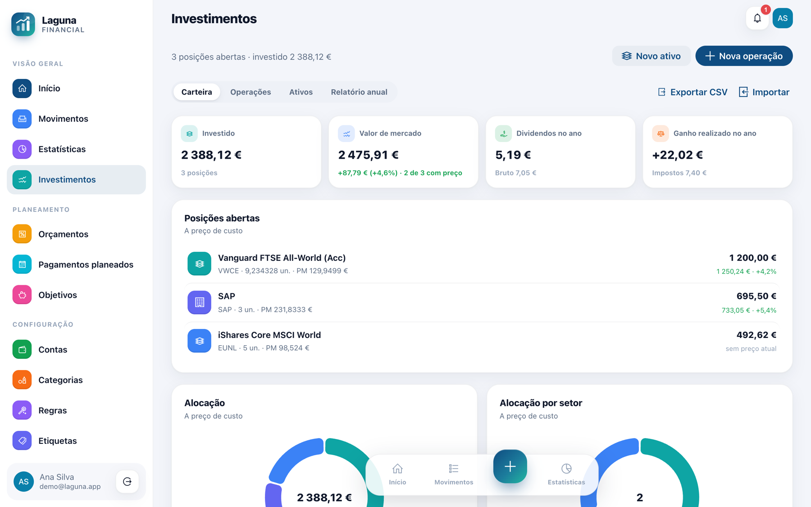
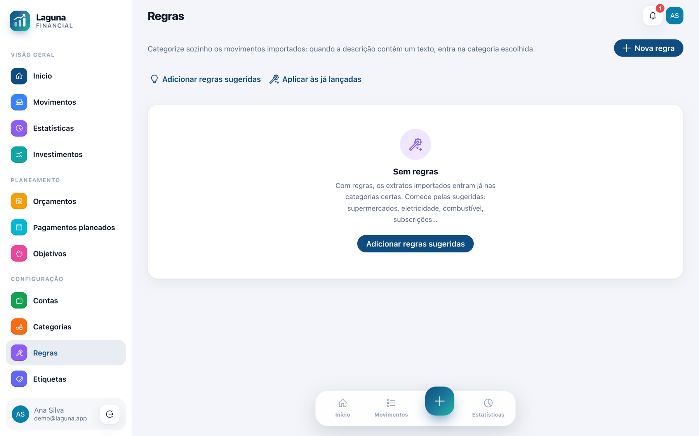
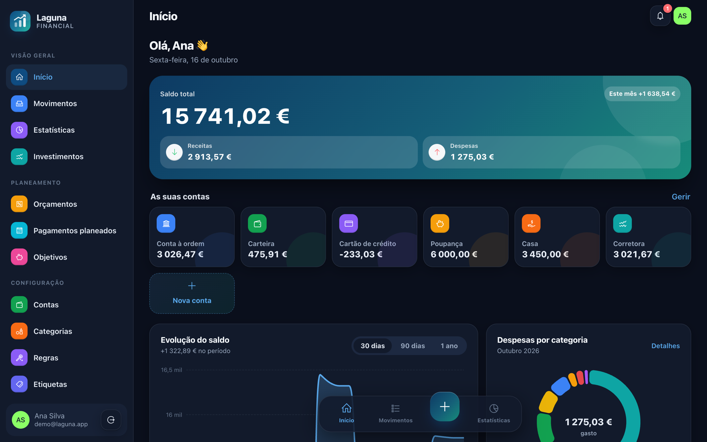

# Laguna Financial

**Gestão financeira pessoal, gratuita e no seu computador.** Saiba quanto tem, para onde vai o dinheiro e se está dentro do orçamento — sem criar conta em lado nenhum e sem os seus dados saírem do seu computador.

**[⬇ Descarregar a última versão](https://github.com/zanettidi/laguna-financial-releases/releases/latest)** · macOS (Apple Silicon e Intel) · Windows · Linux

## O que faz

- **Contas e movimentos** — banco, carteira, cartão, poupanças e investimentos; despesas, receitas e transferências, com categorias, subcategorias e etiquetas.
- **Importar extratos do banco** — o ficheiro CSV que o site ou a app do banco exporta. As colunas são reconhecidas sozinhas e importar o mesmo extrato duas vezes não repete movimentos.
- **Regras de categorização** — "descrição contém CONTINENTE → Supermercado": os movimentos importados já entram na categoria certa.
- **Orçamentos** — semanais, mensais ou anuais, com aviso aos 80 % e aos 100 %.
- **Pagamentos planeados e objetivos** — renda, ginásio, salário, com lembrete; quanto poupar por mês para chegar a um objetivo a tempo.
- **Estatísticas** — fluxo de caixa, despesas e receitas por categoria e por etiqueta, evolução do saldo, comparação com o período anterior.
- **Investimentos** — ações e ETF registados à mão: carteira a preço de custo, dividendos, mais-valias por FIFO e um relatório anual de apoio ao IRS.
- **Cópias de segurança** — uma por semana automaticamente, mais as que fizer à mão, e restaurar com um clique. Exporta também tudo em CSV, que abre no Excel ou no LibreOffice.
- **Português, inglês e espanhol**, tema claro e escuro, e a moeda à escolha (euro, real, dólar, libra…).

| | |
|---|---|
|  |  |
|  |  |
|  |  |

## Os seus dados são seus

- Ficam **no seu computador**, na pasta `.laguna-financial` da sua área pessoal. Não há servidor nosso nem conta online.
- A aplicação só fala com a internet para **ver se há uma versão nova** (consulta este repositório no GitHub; não envia dados seus). Se ligar os avisos no browser, esses avisos passam pelo serviço de notificações do próprio browser.
- A aplicação só aceita ligações do próprio computador (`localhost`): ninguém na sua rede lhe chega.
- Pode exportar tudo a qualquer momento e levar os dados para outro computador copiando a pasta.

## Instalar

Os instaladores trazem o Java e a base de dados incluídos — não é preciso instalar mais nada.

| Sistema | Ficheiro | Como instalar |
|---------|----------|---------------|
| macOS com Apple Silicon (M1, M2, M3…) | `Laguna.Financial-<versão>-apple-silicon.dmg` | Abrir e arrastar para Aplicações. |
| macOS com processador Intel | `Laguna.Financial-<versão>-intel.dmg` | Abrir e arrastar para Aplicações. |
| Windows | `Laguna.Financial-<versão>.msi` | Duplo clique. Instala só para o utilizador, sem pedir administrador. |
| Linux (Debian/Ubuntu) | `laguna-financial_<versão>_amd64.deb` | `sudo apt install ./laguna-financial_<versão>_amd64.deb` |

**Qual é o meu Mac?** Menu Apple (canto superior esquerdo) › **Acerca deste Mac**: se disser "Chip Apple M…", é Apple Silicon; se disser "Processador … Intel", é Intel.

Ao abrir, a aplicação abre no browser (`http://localhost:8081`) e fica um ícone na barra do sistema com **Abrir** e **Sair**. No primeiro uso, crie a sua conta (fica só no seu computador) em "Criar conta"; o guia **Primeiros passos** no Início ajuda a configurar o resto em poucos minutos.

### Primeira abertura (instaladores sem assinatura)
- **macOS:** se disser que não pode verificar o programador, clique direito na aplicação › **Abrir** (ou Definições do Sistema › Privacidade e segurança › **Abrir mesmo assim**).
- **Windows:** no aviso do SmartScreen, **Mais informações** › **Executar mesmo assim**.

## Atualizar

Quando houver uma versão nova, a aplicação avisa no menu lateral ("Nova versão disponível"). Feche-a (ícone › **Sair**) e instale a versão nova por cima — os dados ficam. No Mac, escolha o `.dmg` do seu tipo de Mac. Antes de cada atualização que mude a base, a aplicação guarda uma cópia em `.laguna-financial/backups/`.

## Cópias de segurança

Em Preferências › **Cópias de segurança**: fazer uma cópia agora, uma cópia automática por semana (ficam as 5 mais recentes) e restaurar qualquer cópia. Em Preferências › **Os seus dados** pode também exportar tudo num ZIP de ficheiros CSV.

## Perguntas frequentes

**É mesmo gratuito?** Sim, a versão para o computador é gratuita.

**Liga-se ao meu banco?** Não. Os movimentos entram à mão ou pelo ficheiro do extrato que exporta do banco — a aplicação nunca vê as suas credenciais bancárias.

**Posso usar no telemóvel?** Esta versão é para o computador. Uma versão alojada, com acesso pelo telemóvel e partilha entre casas, está nos planos.

**Esqueci-me da palavra-passe.** Em "Recuperar palavra-passe", o link para a repor fica num ficheiro `repor-palavra-passe.txt` dentro da pasta `.laguna-financial` (não é enviado por email).

**Encontrei um problema ou tenho uma sugestão.** Abra uma [issue](https://github.com/zanettidi/laguna-financial-releases/issues) neste repositório.
